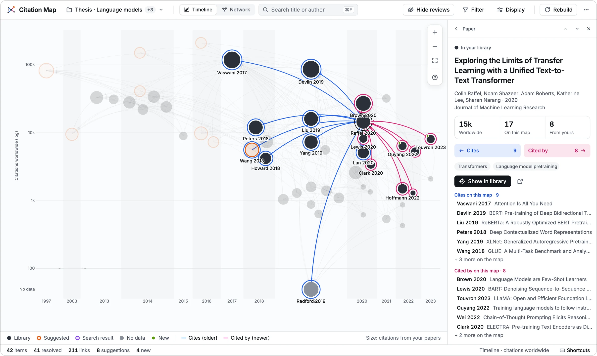
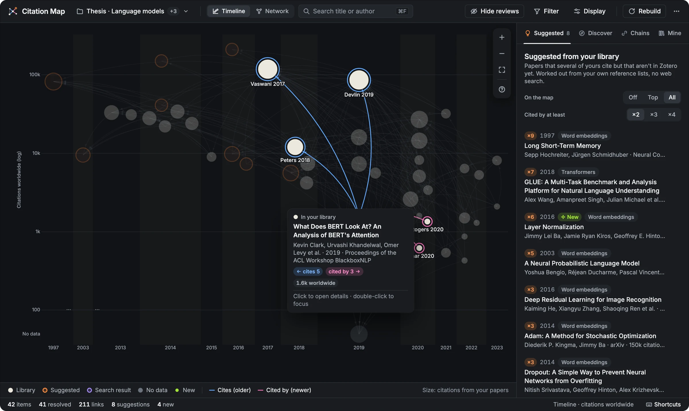
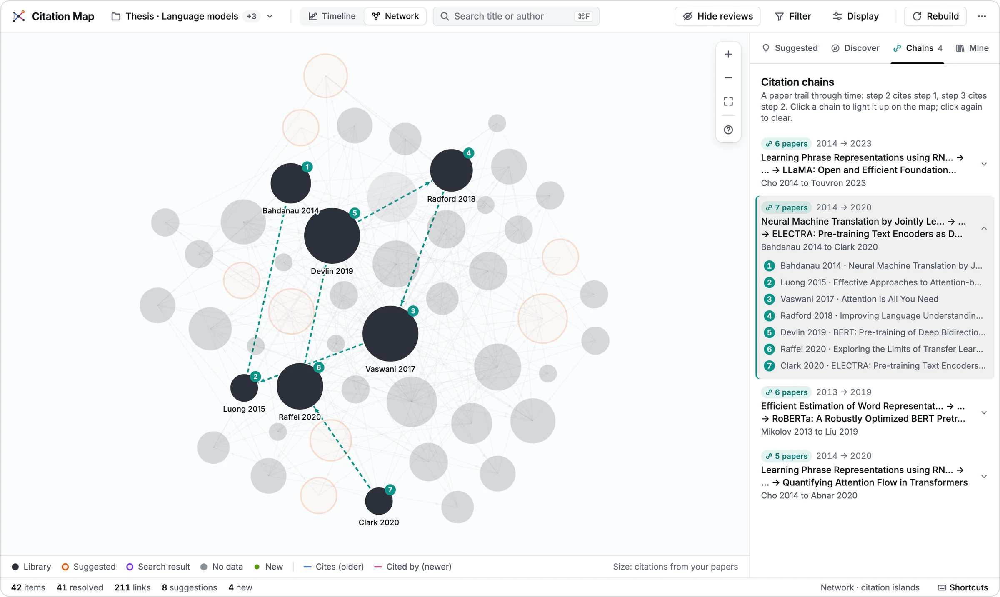
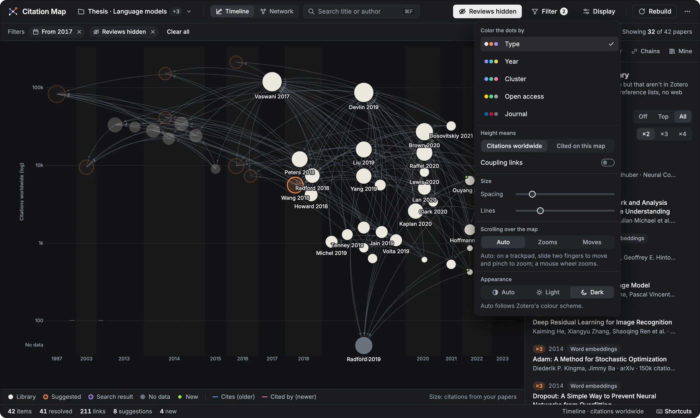

# Citation Map for Zotero


An interactive citation network for your Zotero collections. Instead of a flat
list of papers, you get a living map: every paper is a dot, every citation is
an arrow, and the plugin tells you which important papers you are missing.

Works with **Zotero 7, 8, 9, and 10**, in light and dark mode.



<p align="center">
  
  
</p>

<sub>Screenshots show an example collection; citation counts are illustrative.</sub>

## ⬇️ Download & install

[](https://github.com/schulzedaniel/ZoteroCitationMaps/releases/latest)

**Three steps, about 30 seconds, no account, nothing to configure:**

1. **Click the red button above.** It always opens the newest release, grab
   the `citation-map-*.xpi` file listed under **Assets**.
   *Using Firefox?* Right-click the `.xpi` link → **"Save Link As…"**,
   otherwise Firefox tries to install the file into itself.
2. In Zotero, open **Tools → Plugins**.
3. **Drag the downloaded `.xpi` onto the Plugins window**, or use the
   gear (⚙) menu → **Install Plugin From File…** and pick the file.

That's it. The plugin activates immediately; no restart needed. You can also
[build it from source](#building-from-source).

## What it does

**1. Draws a citation map you can read at a glance.**
Open any collection and it opens as a **Timeline** that reads like a chart:
left → right is the publication year, and the *higher* a paper sits, the
more it is cited (worldwide, log scale), so the classics sit top-left and
fresh work bottom-right. Node size shows how often a paper is cited *within
your own collection*. Hover or click a paper and its links light up:
**blue** lines go to the papers it cites, **pink** lines come from the papers
citing it. Its details open in the sidebar, with both lists, so you can walk
the trail. One click switches to the **Network**, where papers that cite each
other form topic-labelled islands. The map remembers which view you used last.

**Colour always means the same thing.** Filled dots are papers in your
library, open rings are papers you don't have yet; **orange** marks
suggestions, **violet** search results, **teal** citation chains, **blue**
"cites", **pink** "cited by" and **green** what is new. The interface follows
Zotero's light or dark colour scheme, or stays pinned to one (Display →
Appearance).

**2. Discovers papers you should probably read.**
The plugin reads the full reference list of every paper in the collection
(via the open OpenAlex index). When several of your papers all cite the same
*external* work you don't have, it appears on the map as an open orange ring
and in the **Suggested** tab with a `×N` badge ("cited by N of your papers"). One click adds it to your Zotero
collection via its DOI. Suggestions are ranked by *both* how many of your
papers cite them and how well their topics match your collection, so a
relevant paper outranks a generically famous methods paper.

**2b. Searches for new papers, in every direction.**
The **Discover** tab (its own sidebar tab, separate from Suggested) searches
OpenAlex on demand. Suggested is instant and offline (from your own papers'
citations); Discover is a live web search for papers *beyond* your library:

- **Papers that cite yours**, papers that *cite* the papers in your
  collection. The classic suggestions only look backwards in time; this is
  how you find the brand-new work building on your reading list (use the
  **Published** dropdown, Any time / Last 2·5·10 years / a custom year,
  to catch up after a break).
- **Same topics**, well-cited papers in your collection's top OpenAlex
  topics: parallel literature that shares *no* citation link with your
  papers at all.
- **Related**, works OpenAlex marks as related to several of your papers.

Every result explains itself with reason badges ("cites 3 of yours", topic
tags, "related ×2") and offers **Add** (to Zotero, with a "Show in library"
shortcut afterwards) and **Show on map**, a violet ring you can just as
easily take off the map again (or clear all at once). The plugin also shows
your collection's *fingerprint*, its top OpenAlex topics as checkboxes, plus
locally extracted key terms, so you can steer the search.

**3. Traces citation chains.**
Paper A cited Paper B, which cited Paper C… The **Chains** tab lists the
longest chains found in your collection; clicking one lights it up as a teal
thread across the map with numbered steps (1 = oldest), and the row lists
every step with the year span (e.g. `2014 → 2023`).

**4. Timeline: when, and how influential.**
Each publication year is a column (empty years are skipped and marked ⋯, so
a busy 2015–2025 isn't squashed by one old classic), and a paper's height is
its citation count on a log axis with gridlines, starting at the lowest power
of ten in use so well-cited collections use the whole height. **Display →
Height means** switches to *cited on this map* (how many of the papers here
cite it). Papers without a year get an "Undated" column; papers without
citation data rest in a strip under the axis.

**5. Recognises journals by their publisher's colour (opt-in).**
Switch **Display → Color the dots by** to **Journal** and each paper gets a
rim in its publisher's brand colour (Nature, Cell, The Lancet, IEEE, JAMA,
PLOS, ACS, MDPI and ~20 more); journal names in the sidebar get a small
square in the same colour. Colours are nudged so they stay visible on both
the light and the dark background. Unknown journals keep a neutral style; no
logos are downloaded. (By default dots are coloured simply by *type*.)
See [Trademarks & affiliation](#trademarks--affiliation) below.

**6. Display modes, filters & coupling links.**
The **Display** popover switches what the dot colours encode: **type**
(default), publication **year**, citation **cluster** (one colour per island,
each island auto-labelled with the topic its papers share), **open access**
status, or **journal**. It also holds the timeline height, spacing and line
thickness, the scrolling behaviour and the appearance (Auto / Light / Dark),
and can draw dashed *bibliographic-coupling* links between two of your
papers that share many references, "siblings" even when neither cites the
other. **Filter** dims papers outside a year range or a chosen Zotero tag.
The **Hide reviews** toggle in the toolbar takes review / meta-analysis
articles off the map so you can focus on primary research; in the lists they
stay visible but faded, with a Review badge. Active filters appear as
removable chips under the toolbar, with a "Showing 32 of 42 papers" count.
Reviews are detected from OpenAlex's work type, telltale titles (systematic
review, meta-analysis, …) and review-journal names (Nature Reviews, Annual
Review of …, Trends in …).



**7. Shows what changed.**
Rebuilding a collection you've mapped before highlights everything new
since the last build: a small green dot on the map, a New badge in the
sidebar.

Also included: search across titles and authors, paper details with
citation stats, topics, links and your Zotero notes, "Show in library" and
"Open DOI" shortcuts, PNG export (also on a light background for slides)
and JSON export, keyboard shortcuts, and a local cache so rebuilding a map
is instant.

## Usage

- Select a collection in the left pane, then **Tools → Show Citation Map**,
  or right-click the collection → **Show Citation Map for This Collection**.
- With no collection selected, the whole library is mapped.
- If the collection has **subcollections**, the map asks once which of them to
  include (all, only the top collection, or any mix). Your choice is
  remembered per collection and can be changed anytime by clicking the
  collection's name at the left of the toolbar (the `+N` badge shows how many
  subfolders are included).
- First run fetches reference lists from OpenAlex (a few seconds per 50
  papers). Results are cached in `citation-map-cache.json` in your Zotero
  data directory; later runs are nearly instant.
- On **Zotero 10** you can select several collections (Ctrl/Cmd-click) and
  map them together. A saved search, *Unfiled Items* or *Duplicates* maps
  exactly the items it shows.
- **Import/export:** save a map with **More (⋯) → Export JSON**, and reopen it
  with **More → Import JSON** (or **Tools → Import Citation Map
  (JSON)…**), no re-fetching. On import you can optionally
  create a new Zotero collection (placed anywhere you pick in the
  library/collection tree) and add the map's papers to your library by DOI.

### Reading the map

| Element              | Meaning                                                            |
| -------------------- | ------------------------------------------------------------------ |
| Timeline: left → right | Publication year (oldest left)                                   |
| Timeline: height     | Citations worldwide, log scale (or: cited on this map, see Display) |
| Filled dot           | Paper in your library                                              |
| Open orange ring     | Suggested paper (cited by ≥ N of your papers, not in your library) |
| Open violet ring     | Paper found by the Discover search (e.g. it cites your papers)     |
| Grey dot             | In your library, but no DOI / not found in OpenAlex                |
| Arrow                | Points from the citing paper to the cited paper                    |
| Blue / pink lines    | With a paper focused: what it cites / what cites it               |
| Teal dashed thread   | A selected citation chain, numbered from the oldest paper          |
| Grey dashed line     | Coupling: two papers sharing many references (optional layer)      |
| Small green dot      | New since the last build of this collection                        |
| Dot size             | How often the paper is cited within this collection                |
| Coloured dot rim     | Journal mode: the publisher's colour (e.g. IEEE blue, Lancet red)  |
| Muted island caption | Network: the topic the papers of that cluster share                |

The dot *fill* colours follow the **Display** mode (type, year, cluster,
open access or journal); the legend under the map always shows the active
meaning, and hovering a legend entry explains it.

### Controls

- **Trackpad:** slide two fingers to move the map, pinch to zoom.
- **Mouse:** scroll to zoom toward the pointer, drag the background to pan.
  (Display → Scrolling over the map switches between *Auto*, *Zooms* and
  *Moves* if your device needs it; Ctrl/Cmd + scroll always zooms.)
- **Click** a paper for its details · **double-click** it to zoom to it and
  its links · double-click the background to fit everything · in the
  Network, **drag** a paper to pin it (switching views releases it).
- **Keys:** ⌘F / Ctrl+F search · T / N Timeline / Network · + − 0 zoom and
  fit · arrow keys move between papers (click the map first) · Enter opens
  one · A adds the focused suggestion · 1–4 switch tabs · S shows or hides
  the sidebar · Esc closes · ? lists all shortcuts.

Spacing, line thickness and appearance are under **Display**; export, import
and the OpenAlex API key under **More (⋯)**.

## Configuration

Settings live under `extensions.citation-map.*` in
**Edit → Settings → Advanced → Config Editor**:

| Preference              | Default | Meaning                                                                           |
| ----------------------- | ------- | --------------------------------------------------------------------------------- |
| `discoveryThreshold`    | `2`     | Min. number of your papers that must cite an external work before it's suggested  |
| `maxDiscovered`         | `15`    | Max. number of suggestions shown                                                  |
| `includeSubcollections` | `true`  | Default for the subcollection picker (`true` = start with all subfolders checked) |
| `subScopes`             | `{}`    | Remembered per-collection subcollection choice (managed by the picker)            |
| `minChainLength`        | `3`     | Min. papers in a highlighted chain                                                |
| `cacheDays`             | `30`    | Days before cached API data is refreshed                                          |
| `apiKey`                | `""`    | Optional free [OpenAlex API key](https://openalex.org/settings/api): raises OpenAlex's daily budget about tenfold (also under **More → OpenAlex API key…**). See [Privacy](#privacy). |
| `layoutMode`            | `"timeline"` | Which view the map opens in: `timeline` or `force` (Network); remembered from the toolbar toggle |
| `timelineMetric`        | `"global"` | Timeline height: `global` (citations worldwide) or `local` (cited on this map) |
| `mailto`                | `""`    | Legacy OpenAlex "polite pool" e-mail (OpenAlex now uses API keys instead). Only sent if you set it. |
| `appearance`            | `"auto"` | `auto` (follow Zotero's colour scheme), `light` or `dark` (also Display → Appearance and Zotero Settings → Citation Map) |
| `scrollGesture`         | `"auto"` | What scrolling over the map does: `auto` (trackpad moves, mouse wheel zooms), `zoom` or `pan` |
| `journalBranding`       | `true`  | Recognise publishers from journal names (used by the Journal colour mode)         |
| `colorMode`             | `"kind"` | What the dot colors encode: `kind` (default, by paper type), `publisher` (color by journal), `year`, `cluster` or `oa` (also in the Display popover) |
| `hideReviews`           | `false` | Hide review / meta-analysis articles from the map and fade them in the lists (also the toolbar "Hide reviews" toggle) |
| `sidebarWidth` / `sidebarCollapsed` | `340` / `false` | Sidebar width in px (280–520) and hidden state (drag the divider; S or More → Hide sidebar) |
| `discoverSince`         | `"any"` | Remembered Discover time filter (`any`, `2y`, `5y`, `10y`, or a 4-digit year) |
| `showCoupling`          | `false` | Draw dashed bibliographic-coupling links between papers sharing references       |
| `couplingMinShared`     | `3`     | Shared references needed before two papers count as coupled                       |
| `discoverCiting` / `discoverTopics` / `discoverRelated` | `true` | Which Discover sources are enabled by default             |
| `warnItemCount`         | `400`   | Confirm before mapping more items than this; 4× this triggers a strong "may freeze Zotero" warning |

**Tools → Citation Map: Clear API Cache** wipes the local cache.

## How it works

Zotero stores your papers' metadata but not their reference lists, so the
plugin resolves each item's DOI against [OpenAlex](https://openalex.org),
a free and open scholarly index, and reads the `referenced_works` of every
paper. From that single dataset it derives:

- **edges**, references that point at another paper in your collection;
- **suggestions**, external works cited by ≥ threshold of your papers,
  ranked by citers *and* topic overlap with your collection;
- **chains**, longest citation paths, found with a memoized DFS
  (citation graphs are effectively acyclic, so this is fast);
- **coupling**, pairs of your papers sharing several references
  (bibliographic coupling), drawn as an optional dashed layer;
- **profile**, your collection's aggregated OpenAlex topics/keywords,
  plus key terms extracted locally from titles, abstracts and tags
  (the local terms never leave your machine).

The on-demand **Discover** search additionally queries OpenAlex for works
*citing* your papers (`filter=cites:…` with the OpenAlex IDs of your
papers' records), for well-cited works in your top topic IDs, and for the
metadata of tallied related works, transmitting only OpenAlex
identifiers, never your text.

See [`docs/ARCHITECTURE.md`](zotero-citation-map/docs/ARCHITECTURE.md) for the module layout
and the design system, and [`docs/INSTALL.md`](zotero-citation-map/docs/INSTALL.md) for a development setup
(running the plugin from source with hot reload of your edits).

## Building from source

```bash
git clone https://github.com/schulzedaniel/ZoteroCitationMaps.git
cd ZoteroCitationMaps/zotero-citation-map   # the plugin lives in this subfolder
./scripts/build.sh                          # → build/citation-map-2.0.0.xpi
```

No Node.js, no bundler, no dependencies, the plugin is plain JavaScript.

## Privacy

The plugin is designed to be as private as possible. In short: **everything
runs and stays on your machine, and the developer receives no data at all.**

**What is sent, and to whom.** All requests go from *your* computer
directly to the **OpenAlex API** (`api.openalex.org`), operated by
[OurResearch](https://ourresearch.org), a US-based non-profit. Three kinds
of identifiers are transmitted, and nothing else:

- **DOIs** of the mapped items, to retrieve their reference lists
  (every build, unless cached);
- **OpenAlex work IDs** of your papers' records, only when you click
  **Search for new papers** with the *Citing yours* or *Related* source
  enabled (to find works citing/related to those records);
- **OpenAlex topic IDs** from your collection's profile, only when you
  click **Search for new papers** with the *Same topics* source enabled.

All three identify *published papers or public topic categories*, not you.
The work and topic IDs come from OpenAlex's own records, they are never
derived from your text. In particular, the **local key terms** the plugin
extracts from your titles, abstracts and tags (shown as "local terms" in
the Discover section, and used to label map clusters) are computed
entirely on your machine and are **never transmitted to anyone**. Nothing
is fetched by the Discover search until you explicitly click its button.

As with any internet request, OpenAlex's servers technically receive your
**IP address** when your computer contacts them. Because OurResearch is
based in the United States, these requests may be processed outside the
EU/EEA. See the [OpenAlex/OurResearch privacy policy](https://openalex.org/)
for how they handle requests.

**Optional API key (`apiKey`).** OpenAlex answers requests without a key
on a small daily budget per network (shared by everyone behind the same
university or office connection). If that runs out, the map says so plainly
and offers a field for a free [OpenAlex API key](https://openalex.org/settings/api),
which raises the budget about tenfold. The key is stored in your Zotero
settings and sent **only to api.openalex.org**, as an `Authorization` header
(never in the URL), so OpenAlex can attribute the requests to your OpenAlex
account. It is entirely optional; clear the setting to stop sending it.

**Optional e-mail (`mailto`).** The legacy `mailto` setting is still honoured
if you set it (your e-mail is then sent with each request), but OpenAlex now
uses API keys instead, so there is no reason to set it.

**Local data.** API responses are cached in `citation-map-cache.json` inside
your Zotero data directory, on your machine only. You can delete it at any
time via **Tools → Citation Map: Clear API Cache** or by removing the file.
Exported PNG/JSON files are created only where you choose to save them.

**What is never collected.** The plugin contains **no telemetry, no
analytics, no crash reporting, no accounts, and no tracking** of any kind.
The developer never receives your library contents, your queries, or any
personal data. Nothing other than the requests to OpenAlex described above
ever leaves your machine.

**Data controller note.** The plugin runs locally under your control and the
developer processes no personal data. For questions about this plugin,
contact the author via the
[project repository](https://github.com/schulzedaniel/ZoteroCitationMaps/issues).

## Disclaimer & liability

This is free, open-source software provided under the MIT License **"as is",
without warranty of any kind** (see [LICENSE](zotero-citation-map/LICENSE)). To the extent
permitted by applicable law, the author accepts no liability for damages
arising from the use of this software; nothing in this section excludes or
limits liability that cannot be excluded under applicable law (e.g. liability
for intent or gross negligence under German law).

Practical notes:

- The plugin only **reads** your Zotero items and **adds** items you
  explicitly click to add; it never deletes or modifies existing items.
  Nevertheless, back up your Zotero library regularly, as you should anyway.
- Citation data comes from OpenAlex and may be incomplete or contain errors
  (see [Limitations](#limitations)). The map is a research aid, not a
  guarantee of bibliographic completeness or accuracy.
- The OpenAlex API is a free third-party service outside the author's
  control; its availability, coverage, and terms may change at any time.

## Trademarks & affiliation

- This is an independent, community-developed plugin. It is **not
  affiliated with, endorsed by, or sponsored by Zotero** or its developer,
  the Corporation for Digital Scholarship. "Zotero" is a trademark of the
  Corporation for Digital Scholarship; it is used here only to describe
  compatibility ("for Zotero").
- The plugin is likewise **not affiliated with or endorsed by OpenAlex /
  OurResearch**. OpenAlex is used as a public data source; its metadata is
  released under CC0.
- Journal and publisher names recognised by the *Journal* colour mode
  (e.g. Nature, Cell, The Lancet, IEEE, JAMA, PLOS, ACS, MDPI) are
  trademarks of their respective owners. The feature uses generic colour
  cues **solely to identify the venue a paper was published in**
  (nominative/descriptive use). No logos are used or downloaded, and no
  affiliation with or endorsement by any publisher is implied. The feature
  can be disabled via the `journalBranding` setting.
- This plugin is **not affiliated with any other citation-mapping product or
  service**; any similarity in purpose reflects the shared, public nature of
  citation data.

## Contributing

Bug reports and pull requests are welcome! By submitting a contribution
(e.g. a pull request), you agree that your contribution is your own work,
that you have the right to submit it, and that it is **licensed to the
project under the same MIT License** that covers the project
("inbound = outbound"). This keeps the licensing of the project simple and
unambiguous for everyone.

## Limitations

- Items without a DOI (books, reports, old scans) appear as grey dots without
  citation links. Tip: many can be fixed by adding the DOI to the item.
- OpenAlex coverage is excellent for journals but thinner for some
  conferences and preprints; a missing edge usually means missing metadata,
  not a missing citation.
- Very large selections (1000+ items) work, but layout gets crowded,
  mapping per collection is the intended workflow. The plugin asks for
  confirmation above 400 items and warns strongly above 1600 (see
  `warnItemCount`), because very large maps can make Zotero unresponsive
  while they build.

## Changelog

See [CHANGELOG.md](zotero-citation-map/CHANGELOG.md) for the full version history
(current release: **2.0.0**).

## Author

Created and maintained by **Daniel Schulze**
([@schulzedaniel](https://github.com/schulzedaniel)). Bug reports and pull
requests are welcome on the
[project repository](https://github.com/schulzedaniel/ZoteroCitationMaps).

## License

MIT © 2026 Daniel Schulze, see [LICENSE](zotero-citation-map/LICENSE).

The bundled typeface [Inter](https://rsms.me/inter/) is © The Inter Project
Authors and licensed under the
[SIL Open Font License 1.1](zotero-citation-map/addon/content/styles/fonts/OFL.txt).

Data retrieved from [OpenAlex](https://openalex.org) is available under
[CC0](https://creativecommons.org/publicdomain/zero/1.0/). Thanks to the
OpenAlex / OurResearch team for providing an open scholarly index.
